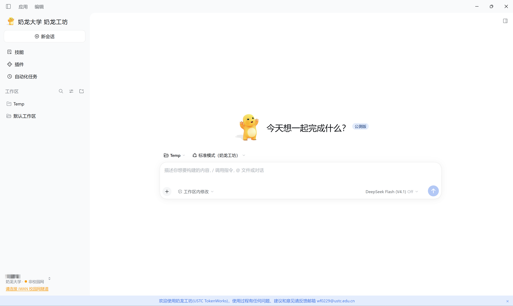

# 🐉 奶龙工坊 · 品牌与内置桌宠

为 Windows TokenWorks 提供一个奶龙品牌替换插件与三款内置桌面宠物，四个组件均可按需独立选择安装。✨

<!-- preview-link:start -->
**[点击预览](https://twinjades.github.io/tokenworks-nailong/)** · 在线查看品牌截图与三款桌宠十状态交互预览！
<!-- preview-link:end -->

| 组件 | 说明 | 来源 | 预览 |
| --- | --- | --- | --- |
| `brand` | 奶龙工坊品牌文字与图标替换 | 本项目代码；图标由用户提供（AI 生成 / MIT） | [](https://twinjades.github.io/tokenworks-nailong/#brand) |
| `nailong-zhengyici` | 精灵图逐帧动画；部分状态复用 | [Zhengyici/nailong-pet-skill](https://github.com/Zhengyici/nailong-pet-skill) | [](https://twinjades.github.io/tokenworks-nailong/#nailong-zhengyici) |
| `nailong-erich207` | 精灵图逐帧动画；部分状态复用 | [erich207/nailong-codex-pet](https://github.com/erich207/nailong-codex-pet) | [](https://twinjades.github.io/tokenworks-nailong/#nailong-erich207) |
| `nailong-mosterpath` | 已透明化静态表情与笑动画（71 图 / 64 帧 4300ms 循环），无声音 | [mosterpath/pet-nailong](https://github.com/mosterpath/pet-nailong) | [](https://twinjades.github.io/tokenworks-nailong/#nailong-mosterpath) |

> 💡 **提示**：品牌截图由用户提供，展示当前挥手奶龙品牌及桌面宠物效果。所有桌宠直接接入 TokenWorks 原生的 **设置 → 桌面宠物** 图库，不运行额外的独立桌宠程序。

---

## 📦 安装与卸载指南

四款组件支持独立按需安装：
- **仅修改外观** ➡️ 只需安装【品牌插件】
- **仅需桌面陪伴** ➡️ 只需安装【桌宠】

### 🎨 1. 品牌插件安装（推荐：通过 TokenWorks 官方插件页）

TokenWorks 原生支持从 GitHub 或本地目录添加插件：

1. 打开 TokenWorks 侧边栏的 **插件 → 添加插件**。
2. 在顶部的 **“包名、GitHub 仓库地址或本地目录路径”** 输入框中粘贴仓库地址：
   ```text
   https://github.com/TwinJades/tokenworks-nailong
   ```
   *(亦可下载本仓库后，直接填入本地项目根目录的绝对路径)*
3. ⚠️ **注意**：下方安装源保持 npm 官方源或大陆镜像即可。**“自定义地址”是 npm registry，切勿在自定义地址栏填写 GitHub 仓库地址！**
4. 点击安装后，在插件列表即可看到“奶龙工坊品牌”，按提示重启客户端即可生效。启用、停用与卸载均在插件管理页面一键操作。

> 📌 **说明**：通过 GitHub 插件管理器安装只会安装品牌插件，**不会**安装桌宠。仓库自带预编译产物，无需 Python 或额外构建。  
> ⚠️ **偶发视觉残留提示**：测试中偶遇卸载后界面品牌未即时刷新的情况。若遇到，请先核对插件列表状态，再完全退出应用（含系统托盘）重开；该间歇问题根因尚未确认。

### 🐾 2. 下载并安装桌宠

**环境要求**：Windows、已安装 TokenWorks、[Node.js 22 或以上](https://nodejs.org/)。

点击 **[下载仓库 ZIP](https://github.com/TwinJades/tokenworks-nailong/archive/refs/heads/main.zip)** → 完整解压 → 退出 TokenWorks（含托盘）→ 双击 **`install.cmd`**，按窗口提示选择安装或卸载。装好后重启，在 **设置 → 桌面宠物** 选择形象。

💡 用完可以删除下载、解压的仓库目录，不影响已安装的桌宠；以后卸载或更新时可能还需要，请保留一份或重新下载。品牌若通过本地目录链接安装，则不要删除其链接目录。

**使用命令打开**：下载解压后，在项目文件夹的 PowerShell 中运行 `Start-Process .\install.cmd`；后续交互仍由你操作，不需要记组件安装命令。

### 🔄 从旧版品牌安装迁移

若你此前曾使用早期脚本直接将品牌装配至产品底层目录：
1. 先完全退出 TokenWorks（含托盘）。
2. 运行 `node scripts/install.mjs uninstall --components brand` 清理历史管理记录（多 profile 时附加 `--profile` 参数）。
3. 工具仅清理本工具记录过的条目，遇到陌生文件或冲突绝不强删。清理完成后重启应用，按照上方**官方插件页**方式重新添加即可。

> 🛡️ 本工具绝不修改 `eduwork.jsonc`、认证地址、用户账号、凭据、对话记录，也不修改你现有的其他桌宠配置。

---

## 🤖 让 Agent 为你安装

让 Agent 帮你下载并打开安装窗口，桌宠选项由你自己操作：

> 请阅读 https://github.com/TwinJades/tokenworks-nailong 这个项目的 docs/agent-install.md。我想安装：[在此处写下你要安装的东西即可]。如果是桌宠，请检查环境、下载并解压仓库，然后打开 install.cmd 交给我操作，不要替我选择或执行安装；如果是品牌，请引导我使用词元工坊官方插件页。

详见 [Agent 安装指南](docs/agent-install.md)。

---

## ✨ 品牌替换行为

- 🔤 **文字替换**：界面中的“中国科学技术大学 / 中国科大”替换为“奶龙大学”，“科大”替换为“奶龙”；“词元工坊 / Token 工坊”替换为“奶龙工坊”。
- 🖼️ **图标覆盖**：覆盖侧边栏、首页 Hero、关于页等品牌插槽，替换可识别的登录页图标与 favicon。
- 🛡️ **严格边界**：跳过聊天对话、消息内容、工具输出、输入框、代码块及外部 iframe；绝不破坏模型交互与身份认证配置。
- 🔄 **安全复原**：正常停用/卸载时撤销本插件改动（偶发刷新限制见上文），不修改原生 EXE 文件、开始菜单与托盘。

---

## 🛠️ 构建与本地预览

```sh
node build.mjs                  # 构建品牌前端脚本
node scripts/build-previews.mjs # 生成桌宠预览数据与待机 GIF
npm run preview                 # 启动本地静态预览站 (http://127.0.0.1:4173)
```
- 品牌构建开箱即用，无新增 npm 依赖。
- 预览缩略图脚本需要 Python 3 及 Pillow（`python -m pip install Pillow==12.3.0`）。

---

## 📄 许可与素材声明

- **项目代码与用户素材**：本项目自有源码基于 [MIT 协议](LICENSE) 开源。`assets/nailong.png` 图标由用户声明为其 AI 生成、应用预览截图由用户自行截取，用户均按 MIT 协议分发（如实记录用户声明，不保证 AI 生成内容必然具有版权）。
- **第三方桌宠素材**：三款桌宠均按其原作者仓库标注的 MIT 协议收录，并完整保留原作者署名、源仓库链接与许可证文件：
  - `nailong-zhengyici`：源自 [Zhengyici/nailong-pet-skill](https://github.com/Zhengyici/nailong-pet-skill)
  - `nailong-erich207`：源自 [erich207/nailong-codex-pet](https://github.com/erich207/nailong-codex-pet)
  - `nailong-mosterpath`：源自 [mosterpath/pet-nailong](https://github.com/mosterpath/pet-nailong)
  - 各组件的上游原始许可证、来源 commit 与透明化处理记录详见各目录的 `UPSTREAM-LICENSE.txt` 与 `third-party/`。
- **运行时支持**：`site/runtime/` 复用宿主 `@eduwork/dsh-desktop-pet` 运行时代码，保留原 LICENSE。
